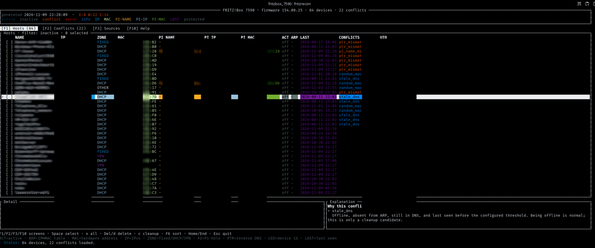
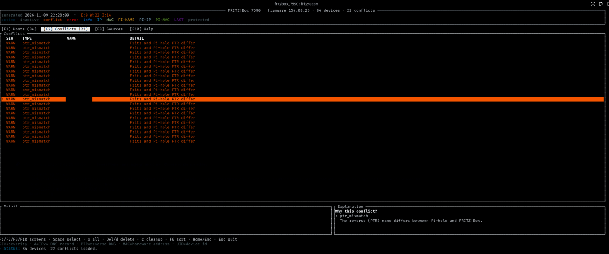
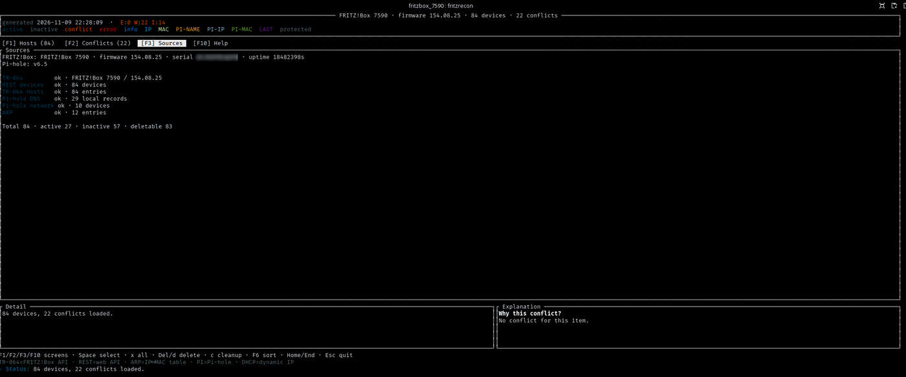
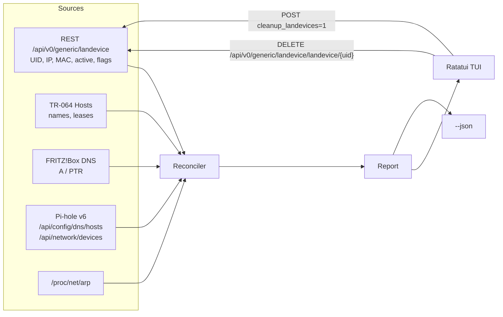

# fritzrecon

[](https://github.com/zx97/fritzrecon/actions/workflows/ci.yml)

**SPDX-License-Identifier:** AGPL-3.0-or-later  
**License:** GNU Affero General Public License v3.0 or later  
**Author:** Manuel FLURY  
**Version:** 0.1.3

Read-only reconciliation for a FRITZ!Box and a Pi-hole, plus explicit cleanup
of the FRITZ!Box device memory.

The tool answers a practical question: **why does `name.fritz.box` still point
to an IP that no longer exists?** It compares:

- the FRITZ!Box REST device list (`/api/v0/generic/landevice`),
- the FRITZ!Box `lastused` timestamp (last time the box saw a device),
- the FRITZ!Box TR-064 `Hosts` service,
- the FRITZ!Box DNS zone (A / PTR),
- the Pi-hole v6 local DNS records and answers,
- the Pi-hole network table (`/api/network/devices`: MAC, IP, last seen),
- the local ARP table.

It reports duplicate names, DNS-only records, stale Pi-hole entries, PTR
mismatches, IP collisions, stale DNS entries and protected entries.

The binary embeds this documentation and the licence: `fritzrecon
--documentation` prints this file, `fritzrecon --licence` prints the AGPLv3
text. Both work offline and without a configuration file.

## Table of contents

1. [Screenshots](#screenshots)
2. [Requirements](#requirements)
3. [Build and install](#build-and-install)
4. [Configuration](#configuration)
5. [Usage](#usage)
6. [Command-line options](#command-line-options)
7. [TUI keys](#tui-keys)
8. [IP zones](#ip-zones)
9. [Conflict types](#conflict-types)
10. [Offline vs stale_dns](#offline-vs-stale_dns)
11. [Pi-hole authentication](#pihole-authentication)
12. [Without a Pi-hole](#without-a-pi-hole)
13. [Safety](#safety)
14. [Architecture](#architecture)
15. [Glossary](#glossary)
16. [Transient FRITZ!Box errors](#transient-fritzbox-errors)
17. [Licence](#licence)

## Screenshots

The screenshots are anonymised: names, addresses, MACs and device IDs are
redacted.

**Hosts** — device list with IP zones, Pi-hole columns, conflicts, detail and
conflict explanation:



**Conflicts** — every reconciliation conflict with severity and explanation:



**Sources** — health and record count of each data source:



## Requirements

- Linux (the ARP table is read from `/proc/net/arp`).
- Rust 1.85 or newer for building (`edition = "2024"`).
- A FRITZ!Box user allowed to read the device list and, for deletions, to
  modify it. The `FRITZ!Box settings` permission is enough
  (`box_admin_rights = ReadWriteLan`).
- Pi-hole is optional. Pi-hole v6 is supported; authentication is optional.

## Build and install

```bash
cargo build --release
```

The result is a single executable (`~5 MB`), `target/release/fritzrecon`.

Install it in `PATH` with:

```bash
cargo install --path .
# or
install -m 0755 target/release/fritzrecon ~/.local/bin/fritzrecon
```

For a fully static binary, install `musl-tools` and the musl target:

```bash
rustup target add x86_64-unknown-linux-musl
cargo build --release --target x86_64-unknown-linux-musl
```

Every release publishes static **amd64/arm64 tarballs**, **.deb** and **.rpm**
packages plus a `SHA256SUMS` file. Download them from the GitHub or GitLab
release page, then:

```bash
# Debian / Ubuntu
sudo apt install ./fritzrecon_<version>-1_amd64.deb

# RHEL / AlmaLinux / Rocky
sudo dnf install ./fritzrecon-<version>-1.x86_64.rpm

# Any Linux (tarball)
tar -xzf fritzrecon-<version>-linux-amd64.tar.gz
install -m 0755 fritzrecon-<version>-linux-amd64/fritzrecon ~/.local/bin/

# Container
docker run --rm --network host ghcr.io/zx97/fritzrecon:latest --config /config.toml --json
```

To build the packages locally, install `nfpm` and run `make dist`; the output
is in `dist/`. See [`packaging/README.md`](packaging/README.md) for the CI
details.

## Configuration

Copy `config.example.toml` to `~/.config/fritzrecon/config.toml`, or pass
`--config`. The password is read from `FRITZ_PASS` first, then from
`fritz.password_file` (relative to the current directory). The password is
never logged.

```bash
mkdir -p ~/.config/fritzrecon
cp config.example.toml ~/.config/fritzrecon/config.toml
chmod 600 ~/.config/fritzrecon/config.toml
```

The defaults target the FRITZ!Box factory LAN (`192.168.178.1`) and a Pi-hole
at `192.168.178.2`; adjust `[fritz]`, `[pihole]`, `[scan] cidrs` and
`[scan.zones]` to your own plan. Set `[pihole] enabled = false` when no
Pi-hole is present.

## Usage

```bash
# Interactive TUI (English by default, spinner while loading)
./fritzrecon

# French UI and CLI messages
./fritzrecon --lang fr

# FRITZ!Box only, without a Pi-hole on the network
./fritzrecon --no-pihole

# Scriptable JSON report
./fritzrecon --json > report.json

# Show what a deletion would do, without sending anything
./fritzrecon --delete landevice1234 --dry-run
./fritzrecon --cleanup-inactive --dry-run

# Delete one or more selected UIDs (confirmation required)
./fritzrecon --delete landevice1234 --delete landevice5678

# AVM cleanup_landevices: delete every inactive device
./fritzrecon --cleanup-inactive

# Read the embedded documentation and licence
./fritzrecon --documentation
./fritzrecon --licence
```

## Command-line options

| Option | Description |
|---|---|
| `-l`, `--licence` | Print the GNU AGPLv3 licence and exit |
| `-D`, `--documentation` | Print this documentation and exit |
| `--config FILE` | TOML configuration file |
| `--lang en\|fr` | UI and CLI language (default: `en`) |
| `--no-pihole` | Disable Pi-hole integration |
| `--json` | Print the JSON report and exit |
| `--delete UID` | Delete a device by UID (repeatable) |
| `--cleanup-inactive` | Delete every inactive device (`cleanup_landevices`) |
| `--dry-run` | Print the requests without sending them |
| `--yes` | Skip the confirmation prompt (scripts) |
| `-h`, `--help` | Show the help |
| `-V`, `--version` | Show the version |

`--delete` and `--cleanup-inactive` write a JSON backup before any request.

## TUI keys

| Key | Action |
|---|---|
| `j` / `k`, arrows | move one row |
| `Home` / `End` or `g` / `G` | top / bottom |
| `PgUp` / `PgDn` | page up / page down |
| `F1` / `F2` / `F3` | Hosts / Conflicts / Sources |
| `F10` (or `F12`) | Help |
| `Esc` | quit, or cancel the confirmation dialog |
| `F5` | reverse the sort direction |
| `F6` | sort menu (htop-style) |
| `f` | cycle filter (all, inactive, conflicts, deletable) |
| `Space` | check/uncheck a device |
| `x` / `X` | check all filtered / clear |
| `Delete` / `d` | delete checked devices (type `DELETE`) |
| `c` | AVM cleanup of inactive devices (type `CLEAN`) |
| `r` | refresh |
| `e` | export the JSON report |
| `q` | quit |

The Hosts table shows the FRITZ!Box view (`NAME`, `IP`, `MAC`), the Pi-hole
network view (`PI NAME`, `PI IP`, `PI MAC`), `ACT`, `ARP`, `LAST` (FRITZ!Box
`lastused`), `CONFLICTS` and `UID`. The bottom pane is split: the left side
keeps the selected device's detail, the right side explains the conflict
codes.

The default filter is **inactive**. The box itself, mesh gateways and entries
flagged `device_not_deleteable` / `ownentry` are protected and cannot be
checked.

Colours: green = active / ARP present, gray = inactive / no ARP, red or
yellow = conflict, cyan = FRITZ!Box MAC, light blue = FRITZ!Box IP, light
green = Pi-hole IP, light cyan = Pi-hole MAC, magenta = last seen, dim =
protected. The legend is shown in the header; the full key list is on the Help
screen (`F10`).

The `LAST` column is the FRITZ!Box `lastused` timestamp, formatted in local
time (`-` when the box has never recorded a value). It is also present in the
JSON report as `last_seen`.

## IP zones

The tool labels each address with a zone, using CIDRs from `[scan.zones]`:

| Zone | Default | Meaning |
|---|---|---|
| `FIXED` | `192.168.178.0/24` | manually assigned addresses |
| `DHCP` | empty | DHCP pool |
| `VPN` | empty | VPN addresses |
| `OTHER` | anything else | not covered by the plan |

Example for a network split by usage:

```toml
[scan.zones]
fixed = ["10.0.0.0/24"]
dhcp  = ["10.0.1.0/24"]
vpn   = ["10.0.2.0/24"]
```

Each list accepts one or more CIDRs. An address matched by no list is
`OTHER`; malformed CIDRs are ignored.

`duplicate_name` is only reported **inside the same zone**. The same name in
several zones is `multi_zone` (blue, informational) and is often normal for a
single device with a LAN and a VPN address. The same name repeated inside the
same zone (usually because of a randomized MAC or an old lease) is
`duplicate_name`, a yellow warning, not an error.

`random_mac` (blue, informational) marks devices whose FRITZ!Box `flags`
contain `randommac`: the box may create a new entry each time the private MAC
changes. This is normal but explains many duplicate entries.

## Conflict types

| Code | Severity | Meaning |
|---|---|---|
| `dns_only` | error | A DNS name exists in the FRITZ!Box or Pi-hole but has no device entry |
| `pi_mismatch` | error | The same name resolves to different IPs in the FRITZ!Box and the Pi-hole |
| `ip_collision` | error | Two names claim the same IP |
| `duplicate_name` | warning | The same name appears twice in the same IP zone |
| `case_duplicate` | warning | Names differ only by case |
| `ptr_only` | warning | A PTR record exists without a matching A record |
| `ptr_mismatch` | warning | A and PTR disagree (often `.fritz.box` vs `.lan`) |
| `pi_orphan` | warning | A Pi-hole record points to an address the Pi-hole no longer serves |
| `pi_only` | warning | A Pi-hole device has no FRITZ!Box counterpart |
| `multi_zone` | info | The same name exists in several IP zones |
| `random_mac` | info | The device uses a randomized/private MAC |
| `stale_dns` | info | An offline device is still present in DNS after `stale_after_days` |
| `duplicate_a` | row flag | One name has several FRITZ!Box A records |
| `pi_network_mismatch` | row flag | The Pi-hole network table reports another IP |
| `pi_mac_mismatch` | row flag | The Pi-hole network table reports another MAC |
| `pi_name_mismatch` | row flag | The Pi-hole network name differs from the FRITZ!Box name |

`row flag` entries are shown in the device row and its detail pane; they do
not create a separate entry in the Conflicts screen.

## Offline vs stale_dns

An offline device is **not an error**. `stale_dns` is an informational flag
shown in blue: the device is offline, absent from ARP, still present in the
FRITZ!Box DNS, and its last-seen time is older than `scan.stale_after_days`
(default 30 days). It is only a cleanup candidate, not a reconciliation
conflict. Set `stale_after_days` to a higher value, or ignore it, if you want
to keep old entries.

## Pi-hole authentication

Pi-hole v6 uses a single web password (no username). If authentication is
disabled, fritzrecon reads the API anonymously. If it is enabled, configure:

```toml
[pihole]
password_file = "/home/user/.config/fritzrecon/pihole.pass"
password_env = "PIHOLE_PASS"
# totp_file = "/home/user/.config/fritzrecon/pihole.totp"
# totp_env = "PIHOLE_TOTP"
```

Priority: `PIHOLE_PASS` (non-empty environment variable), then
`password_file` (trimmed), then no authentication. The client logs in with
`POST /api/auth` (`{"password": ...}`, plus `totp` when configured), stores the
returned `session.sid`, and sends it as `X-FTL-SID` on every read. A 401
renews the session once. The password/TOTP is never logged.

The file must contain only the password, with `0600` permissions:

```bash
mkdir -p ~/.config/fritzrecon
install -m 600 /dev/null ~/.config/fritzrecon/pihole.pass
printf '%s' 'mon-mot-de-passe' > ~/.config/fritzrecon/pihole.pass
```

This only affects fritzrecon's read-only API calls. The sync scripts used by
the author use SSH and root access to edit `/etc/hosts` and `pihole.toml`, so
they are not affected by Pi-hole authentication.

fritzrecon queries only the Pi-hole configured in `[pihole] url`. To compare a
second Pi-hole, run a second instance with another configuration file, or add
it later; a single upstream is enough for reconciliation.

## Without a Pi-hole

The Pi-hole is optional. Use `--no-pihole` or set `[pihole] enabled = false`.
The tool then reconciles the FRITZ!Box device database, its DNS A/PTR zone and
the local ARP table only. The `PI *` columns show `-`, Pi-hole-specific
conflicts (`pi_mismatch`, `pi_orphan`, `pi_only`, …) are skipped, and the
Sources screen reports `Pi-hole: disabled`.

## Safety

- No write happens without an explicit confirmation word.
- Before every deletion (selected or global), a JSON backup is written to
  `~/.local/share/fritzrecon/`.
- `--dry-run` prints the exact REST calls and sends nothing.
- Deleting a device removes its entry from the box's device memory. A device
  that is still connected will reappear when it reconnects.
- `cleanup_landevices` is the same action as the AVM button "delete
  disconnected devices". It can remove DHCP reservations; review the dry-run
  list first.

### Delete vs cleanup

| Action | Key | Scope |
|---|---|---|
| Delete | `d` | Only the checked devices, one `DELETE` request per UID |
| Cleanup | `c` | Every inactive device at once (`cleanup_landevices`); the current selection is ignored |

Delete is surgical and works on active or inactive devices. Cleanup is the
global AVM action and is broader: it removes all inactive entries, including
old DHCP reservations.

## Architecture



Source files:

| File | Responsibility |
|---|---|
| `src/main.rs` | CLI parsing, JSON output, delete/cleanup, embedded docs/licence |
| `src/config.rs` | TOML configuration and credential resolution |
| `src/fritz.rs` | FRITZ!Box web login, TR-064 SOAP, REST device API |
| `src/pihole.rs` | Pi-hole v6 API client (hosts, network devices, auth) |
| `src/dns.rs` | Minimal UDP DNS query client |
| `src/reconcile.rs` | Reconciliation rules, zones, conflicts, report |
| `src/tui.rs` | Ratatui interface, sorting, details, confirmations |
| `src/i18n.rs` | English/French strings |

## Glossary

| Term | Meaning |
|---|---|
| `A` | IPv4 DNS record |
| `PTR` | reverse DNS record (IP → name) |
| `MAC` | hardware address of the network card |
| `IP` | IPv4 network address |
| `ARP` | local IP ↔ MAC table |
| `UID` | FRITZ!Box device identifier used for deletion |
| `PI` | Pi-hole |
| `PI NAME` | hostname as known by the Pi-hole network table |
| `ACT` | active / currently connected |
| `LAST` | last time the FRITZ!Box saw the device |
| `SEV` | severity (ERROR / WARN) |
| `DHCP` | dynamic host configuration protocol |
| `E/W/I` | counts of errors / warnings / informational flags |
| `ZONE` | `FIXED` / `DHCP` / `VPN`, from the `[scan.zones]` CIDRs |
| `multi_zone` | same name in several IP zones (informational) |
| `random_mac` | device using a randomized/private MAC (informational) |

The footer shows a context-sensitive reminder; the full list is on the Help
screen (`F10`).

## Transient FRITZ!Box errors

Right after deleting devices, the TR-064 host table can change between
`GetHostNumberOfEntries` and `GetGenericHostEntry`. A stale index returns
UPnP error 713 (`SpecifiedArrayIndexInvalid`). The tool:

- skips invalid indexes instead of aborting the TR-064 source;
- retries the host-table read a few times with a short backoff;
- if the box is still busy/resynchronizing, shows
  `Waiting for the FRITZ!Box… Reloading in N s…` and retries automatically
  up to three times (`r` retries immediately, `q`/`Esc` quits);
- turns raw SOAP/HTML errors into short actionable messages in the Sources
  screen.

The REST device list remains the authoritative source for UIDs and deletion.

## Notes

- TR-064 lives on `http://<box>:49000`; the REST API lives on the normal web
  port 80. Both URLs are configurable.
- The device deletion path is `/api/v0/generic/landevice/landevice/<UID>`,
  not `/api/v0/landevice/<UID>`.
- The global cleanup path is `POST /api/v0/generic/landevice` with
  `{"cleanup_landevices":"1"}`.

## Licence

fritzrecon is free software: you can redistribute it and/or modify it under
the terms of the **GNU Affero General Public License as published by the Free
Software Foundation, either version 3 of the License, or (at your option) any
later version** (`AGPL-3.0-or-later`).

It is distributed in the hope that it will be useful, but **WITHOUT ANY
WARRANTY**; without even the implied warranty of MERCHANTABILITY or FITNESS
FOR A PARTICULAR PURPOSE. See the `LICENSE` file for the full text, or run
`fritzrecon --licence`.

Copyright © 2026 Manuel FLURY. All rights reserved.
